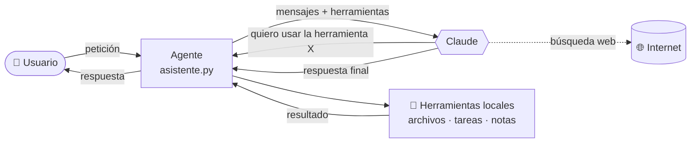

# 🤖 Asistente Personal con IA

> Un agente de inteligencia artificial que se usa desde la terminal y ayuda con las tareas de todos los días: organizar archivos, llevar pendientes, redactar correos y buscar información en internet.


---

## 📌 Sobre el proyecto

Quería un asistente que no solo respondiera preguntas, sino que **hiciera cosas en mi computadora**. Por ejemplo, ordenar la carpeta de Descargas o recordarme mis pendientes, siempre pidiendo permiso antes de cambiar algo.

El resultado es un **agente de IA**: un programa que recibe una petición en lenguaje natural, decide qué herramientas necesita (leer una carpeta, guardar una tarea, buscar en la web…), las usa y repite hasta terminar el trabajo.

### ¿Qué puede hacer?

| Área | Ejemplos |
|---|---|
| 📁 **Archivos** | *"Organiza mi carpeta de Descargas por tipo"* · *"Busca mis PDFs de facturas"* · *"Resume este documento"* |
| ✅ **Tareas y notas** | *"Recuérdame pagar la luz el viernes"* · *"¿Qué tengo pendiente?"* · *"Anota esta idea"* |
| ✉️ **Correos y textos** | *"Redacta un correo pidiendo un día libre"* · *"Traduce esto al inglés"* · *"Guárdalo como borrador"* |
| 🌐 **Internet** | *"¿Qué clima hará mañana en Bogotá?"* · *"Resume esta página web"* |

### Ejemplo de uso

```text
Tú: recuérdame pagar la luz el viernes

  🔧 obtener_fecha_hora()
  🔧 agregar_tarea(descripcion='Pagar la luz', fecha_limite='2026-11-13')

Asistente: ¡Listo! Agregué "Pagar la luz" para el viernes 13 de noviembre.
```

---

## 🧠 Cómo funciona

El asistente sigue el ciclo básico de cualquier agente de IA: **pensar → usar una herramienta → ver el resultado → repetir**.



1. El usuario escribe una petición.
2. El programa se la envía a Claude junto con la **lista de herramientas** disponibles.
3. Claude decide si necesita una herramienta (por ejemplo `listar_carpeta`). El programa la ejecuta **en la PC** y le devuelve el resultado.
4. El ciclo se repite hasta que Claude tiene toda la información y responde.

### Herramientas del agente

| Herramienta | Qué hace |
|---|---|
| `obtener_fecha_hora` | Consulta el día y la hora (para entender "mañana" o "el viernes") |
| `listar_carpeta` / `buscar_archivos` / `leer_archivo` | Explora y lee archivos |
| `crear_carpeta` / `mover_archivo` | Organiza archivos (**con confirmación del usuario**) |
| `agregar_tarea` / `listar_tareas` / `completar_tarea` | Lista de pendientes guardada en JSON |
| `guardar_nota` / `leer_notas` | Notas personales con fecha |
| `guardar_borrador` | Guarda correos y textos como `.txt` |
| `web_search` / `web_fetch` | Busca en internet y lee páginas (se ejecutan en los servidores de Anthropic) |

---

## 🔒 Seguridad

Un agente que puede tocar archivos necesita límites claros:

- **Zona limitada:** solo puede acceder a archivos dentro de la carpeta del usuario. Cualquier ruta fuera de ella se rechaza.
- **Confirmación obligatoria:** cada vez que quiere mover o renombrar un archivo, el programa pregunta `(s/n)` antes de hacerlo.
- **Sin borrado:** a propósito, el agente no tiene ninguna herramienta para eliminar archivos.
- **Sin sobrescribir:** si el destino ya existe, no lo reemplaza.
- **Clave protegida:** la clave de API se pide de forma oculta y nunca se guarda en el código.

---

## 🚀 Dos formas de usarlo

### Opción A: con Claude Code (sin clave de API)

Si tienes un plan de Claude (Pro o Max), la carpeta incluye un archivo [`CLAUDE.md`](CLAUDE.md) que convierte a **Claude Code** en el asistente. No hay que programar nada:

```bash
cd asistente-ia
claude
```

Claude Code lee las instrucciones de `CLAUDE.md`: responde en español, guarda las tareas en `tareas.md` y las notas en `notas.md`, y pide permiso antes de mover archivos.

### Opción B: programa propio en Python (con la API de Anthropic)

```bash
git clone https://github.com/Stikyu/asistente-ia.git
cd asistente-ia
pip install -r requirements.txt
python asistente.py
```

En Windows también puedes hacer doble clic en **`iniciar.bat`**. La primera vez te pedirá una clave de API, que se crea en [console.anthropic.com](https://console.anthropic.com/settings/keys).

**Comandos:** `nuevo` empieza otra conversación · `salir` cierra el programa.

---

## 🛠️ Tecnologías y decisiones

- **Python 3** con el [SDK oficial de Anthropic](https://github.com/anthropics/anthropic-sdk-python).
- **Claude Opus 5.5** con *pensamiento adaptativo*: el modelo decide cuánto razonar según la dificultad de la petición.
- **Bucle de agente propio:** el ciclo de herramientas está escrito a mano, para entender cada paso y controlar la confirmación del usuario.
- **Caché de prompts:** reutiliza lo que ya se envió en la conversación, así cada mensaje nuevo cuesta menos.
- **Respaldo automático:** si el modelo rechaza una petición, la API la reintenta con otro modelo.
- **Datos locales:** las tareas y notas se guardan como archivos en la PC, sin base de datos externa.

## 📂 Estructura

```text
asistente-ia/
├── asistente.py       # El agente: herramientas + bucle de conversación
├── iniciar.bat        # Abre el asistente con doble clic (Windows)
├── CLAUDE.md          # Instrucciones para usarlo con Claude Code
├── requirements.txt   # Dependencias de Python
└── datos/             # Tareas y notas (se crea sola, no se sube a GitHub)
```

## 🗺️ Próximas ideas

- [ ] Notificaciones de Windows cuando una tarea está por vencer
- [ ] Conexión con Google Calendar
- [ ] Bot de Telegram para usarlo desde el celular
- [ ] Interfaz web sencilla

---

## 👤 Autor

**Stikyu**: proyecto hecho para aprender cómo funcionan los agentes de IA y cómo darles herramientas de forma segura.

Licencia [MIT](LICENSE).
